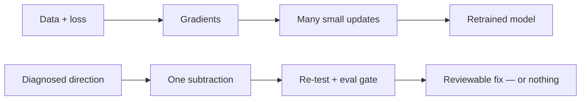

# wsp-kit by Aurem


## Problem → Edit → Result — our real runs

- **Problem:** Qwen3-0.6B and SmolLM2-1.7B looped on 60-item lists — asking for 60 different animals gave repeats.
- **Edit:** a tiny weight change — 131,072 weights (0.022%) on Qwen, 129,897 weights (0.0076%) on SmolLM2. No retraining, no gradients.
- **Result:** Qwen 37.78 → 67.22 (+29.44); SmolLM2 76.11 → 85.56 (+9.44). Good and neighbours stayed at 100. Both passes are quick evidence (3 failing prompts), not reproducible from this repo yet.
- **Gate:** 2 of 7 runs passed. The other 5 were refused and shipped 0 weights.
- **Proof:** every run, pass and fail, is published in [REAL-RUNS.md](REAL-RUNS.md).

> **wsp-kit by Aurem** — an engineering tool for small models. Try to fix small AI models by editing their weights directly — no retraining, no fine-tuning, no gradients — with an eval gate deciding whether any edit ships.

[](LICENSE)
[](RESEARCH.md)
[](https://github.com/AuremHQ/weight-space-programming)


> From the team building **Ora by Aurem — https://auremcto.com** — an AI engineer for non-technical founders. ORA itself stays private; this skill is public so anyone can use it on their own models.

> 🌐 **Website:** https://auremhq.github.io/weight-space-programming/ — the full detailed guide: our vision, the kit's performance, and Aurem's other software.

> ⭐ **Star this repo** — your one star encourages our team to keep building incredible things, free for everyone, and to grow this community. The real runs are live below, with honest numbers.
> 🔁 **Share it** with anyone running a small open model with one stubborn failure.

---

## The 30-second version

- **MIT CSAIL showed** a frontier model can read and write neural network weights directly — no training, no gradients.
- **One tiny edit** (0.016% of weights) fixed a model's reasoning loop: MATH **7.9% → 48.1%**.
- **This repo turns that idea into a skill** you can run on your own small open-weight model — with evaluation, not enthusiasm, deciding whether any edit ships.

**This repo is not affiliated with MIT.** It is an independent implementation inspired by their public research, with full credit below.

---

## Real runs — our numbers (not MIT's)

We ran the kit on **real models** — Qwen3-0.6B, GPT2-124M, and SmolLM2-1.7B-Instruct, local CPU, no LLM editor. **7 real runs, 2 gate passes.** Here is what actually happened. Full numbers: [REAL-RUNS.md](REAL-RUNS.md).

| Run | Model | Failure | Diagnosis | Causal proof | Weights changed | Gate |
|---|---|---|---|---|---|---|
| **Pipeline test** | Kit weights (smoke test) | Failing 64.14 vs good 75.98 | Row 0 | **+18.00 — PASSED** | **128 (0.77%)** | **PASSED — failing 64.14 → 75.43 (+11.29)** |
| **Qwen run 1** | Qwen3-0.6B | 60-item lists loop (60 animals → only 16 distinct) | Layers [27, 26] | −3.33 — FAILED | **0** | **FAILED — nothing shipped** |
| **Qwen run 2** | Qwen3-0.6B | Same failure | Layers [27, 26] | **+32.22 — PASSED** | **0** | **FAILED — nothing shipped** (attempt numbers contaminated by a restore bug — see clean re-run) |
| **Qwen clean re-run** | Qwen3-0.6B | Same failure, restore bug fixed | Layers [27, 26] | **+32.22 — PASSED** | **0** | **FAILED — nothing shipped** (all 3 clean attempts made failing worse: −11.11 / −11.11 / −12.22) |
| **GPT-2 run** | GPT2-124M | 60-item lists loop (animals 1.7, countries 5.0, fruits 1.7) | Layers [10, 11] | −1.11 — FAILED | **0** | **FAILED — nothing shipped** |
| **Qwen narrow Try 1** | Qwen3-0.6B | 60-item lists loop, narrow eval | Layers [27, 26] | **+23.89 — PASSED** | **0** | **FAILED — nothing shipped** (all 3 subtraction attempts destroyed the model at greedy) |
| **Qwen narrow dampen** | Qwen3-0.6B | Same failure, narrow eval | Layers [27, 26] | **+23.89 — PASSED** | **131,072 (0.022%)** | **PASSED — failing 37.78 → 67.22 (+29.44)** |
| **SmolLM2 run** | SmolLM2-1.7B-Instruct | 60-item lists loop (Butterfly ×2, Elephant ×2, Giraffe ×3) | Layer 23 | −30.00 — PASSED the v1 bar (|−30| ≥ 5), though the ablation made it worse | **129,897 (0.0076%)** | **PASSED — failing 76.11 → 85.56 (+9.44)** |

**What this proves:** the kit runs end-to-end on real models, finds real failures, diagnoses real layers — and **the gate works**: 5 of 7 runs were refused, and **2 real-model edits passed the gate** (SmolLM2 by subtraction, Qwen narrow by dampening).
**What it does not prove yet:** that the kit fixes real models in general. 2 passes out of 7 runs, both on the same narrow failure (60-item list looping) — that is the claim, not a general proof.

---

## Where it started — MIT's numbers

```
MATH-500           7.9%  ████░░░░░░░░░░░░░░░░  →  48.1% ████████████████████
GSM8K             13.8%  ██████░░░░░░░░░░░░░░  →  67.1% ██████████████████████████
IFEval            21.0%  ████████░░░░░░░░░░░░  →  62.3% █████████████████████████
Answers hitting the token limit    93%  →  33%
Weights changed: 131,072 — just 0.016% of the model
```

How: the model (Qwen3.5-0.8B) kept getting stuck repeating itself until it ran out of tokens. The researchers traced the loop to one direction written by the MLPs of layers 15 and 19, and subtracted it. The model didn't learn new math — **it already knew the math; the loop was hiding it.**

Full details, all 8 experiments, and the honest limits: see [RESEARCH.md](RESEARCH.md).

---

## Founder's vision

> **Big AI should not belong only to people who can pay for big models and big retraining bills.**
> Small, local, cheap models are already in everyone's hands — they just need to perform at their best. This kit exists to make a small local model give **better results**, one tiny proven edit at a time, without retraining and without sending your data anywhere. If the numbers don't improve, nothing ships. That honesty is the product.
>
> **This kit is free for everyone, and it stays free.** A small model should not mean bad results — everyone has the right to the best experience and the best results. The team's vision is simple: everyone should benefit from this kit.

**— Tejinder Sandhu**, founder, Ora by Aurem ([auremcto.com](https://auremcto.com)) · [Tejinder Sandhu on LinkedIn](https://www.linkedin.com/in/tejinder-sandhu-156a3a181)

---

## How the skill works


1. **Detect** — Find the weights in your repo, run your model on your own test prompts, diagnose the failure, and measure it first (how often, how bad) — that baseline is what the eval gate compares against. No weights or no test prompts → the skill refuses, clearly, and does nothing.
2. **Fix** — Subtract the offending direction from the identified layers only. Edits are tiny by design: anything over 1% of weights is rejected as "too broad."
3. **Eval-gate** — Re-run the *same* prompts with the *same* settings. The fix ships only if the primary metric improves by at least 2 points with no guard-metric regression worse than 2 points. Otherwise the edit is discarded. **No gate, no ship.**

Refusals — what the kit refuses, and how each is enforced:
- No eval file (no test prompts from you): enforced in code — the run stops with a plain message (exit 2), nothing edited.
- No weights (API-only model): partially enforced — the model loader fails and the run stops with a plain message (exit 2), nothing edited; there is no dedicated pre-check.
- Add capability with no diagnosed obstacle: SKILL.md only — not enforced in code.
- Edit a production branch in place: SKILL.md only — not enforced in code.
- Remove safety/refusal behaviour: SKILL.md only — not prevented in code; the v2 default guard bundle detects refusal regression after an edit, it does not prevent safety removal.

Full rules, refusals, and safety gates: see [SKILL.md](SKILL.md).

## How this differs from gradient descent

Gradient descent trains: data + loss → gradients → many small updates → a retrained model. This skill is a different path: one direct edit, no data, no gradients, no training loop — and the eval gate decides whether it ships.



If you want training, use training. If you want to try removing one stubborn failure without retraining, use this.

---

## What's inside

- **[RESEARCH.md](RESEARCH.md)** — the MIT research, explained simply: what weight-space programming is, all 8 experiments with numbers, and where it fails.
- **[SKILL.md](SKILL.md)** — the Weight-Space Programming skill: the 3-step workflow, hard refusal rules, and safety gates.
- **[REAL-RUNS.md](REAL-RUNS.md)** — our real-model runs (Qwen + GPT-2 + SmolLM2) with full numbers, honest gate verdicts, and what they prove.
- **[DEMO-PLAN.md](DEMO-PLAN.md)** — how the real runs were built, and the exact bar the next run must clear.
- **[kit/](kit/)** — the runnable kit: engine, CLI, MCP server, task pack, and the universal real-model pipeline (`wsp run`).

---

## Run it

The skill is runnable as `wsp-kit`. From a clone:

```
pip install './kit[real]'
wsp demo
```

`wsp demo` runs the quick pipeline check end to end and writes `report.json`. For a real model:

```
wsp run --model Qwen/Qwen3-0.6B --eval kit/evals/loop-fix-qwen3-0.6b.json --out-dir out
```

That runs the full gated pipeline — temperature sweep, baselines, diagnosis, causal proof, up to 3 edit attempts — and writes `report.json`. If the gate fails, the out-dir holds only the report: **nothing ships**.

Safety flags (Phase 1):

| Flag | Commands | What it does |
| --- | --- | --- |
| `--force` | `run`, `apply-edit`, `merge` | Allow an out-dir that already holds model files. Without it, the kit refuses to write over model weights. |
| `--allow-quick` | `serve-model`, `apply-edit` | Accept a report with no SHIP verdict (QUICK evidence — every report written before Phase 2). Without it, only SHIP reports are applied. |
| `--allow-unverified` | `apply-edit` | Apply an edit with no `report.json` next to it (no gate pass tied to the edit). |
| `--verify` | `apply-edit` | After applying, compare the sha256 of the changed tensors with `--expected-sha256` and print MATCH or DIVERGED (exit 1 on DIVERGED). |
| `--expected-sha256 HEX` | `apply-edit` | Recorded sha256 of the changed tensors (from the run's PROVENANCE.md); required with `--verify`. |
| `reproduce <run-dir>` | `reproduce` | Re-run a recorded run and print MATCH or DIVERGED on the primary metric within `--tolerance` points (default 5.0); early reports with missing samples/seed/max tokens print "cannot be reproduced exactly: missing <fields>". |
| `--token TOKEN` (or `WSP_TOKEN`) | `serve-model` | Require a bearer token for `POST /generate` and `/rollback`. `/status` stays open. |
| `--protocol v1\|v2` | `run`, `watch`, `loop`, `merge` (`auto` defaults to v1) | v2 is standard evidence (default). `--protocol v1` restores the old measurement, labelled QUICK, never evidence. |
| `--dry-run` | `run` | Print the cost plan (prompt counts, exact generate calls per phase, total) and exit without loading or writing anything. |
| `--no-default-guards` | `run` | Turn the default guard bundle off (v2 only; the report records guards as disabled). |
| `--samples-per-prompt N` | `run`, `watch`, `loop`, `merge` | Samples at non-greedy temperatures (default: 1 for v1, 3 for v2). |

For agents and harnesses, the kit pipeline is available as an MCP server — demo only: every tool drives the built-in toy model, not a real model; use `wsp run` for real models (requires `pip install 'wsp-kit[mcp]'` first):

```json
{
  "mcpServers": {
    "wsp-kit": {
      "command": "python",
      "args": ["-m", "wsp.mcp_server"]
    }
  }
}
```

---

## Who this is for

| ✅ This is for you if… | ❌ This is NOT for you if… |
|---|---|
| You have a **small open-weight model** (Qwen, Gemma, Llama class) in your own app or software | Your model is served by an API (ChatGPT, Claude…) — its weights are never in your hands |
| It has **one specific, repeatable failure** — looping, a stuck behaviour, a narrow quirk | You want to "make my model smarter" — editing removes obstacles, it does not add abilities |
| You have test prompts that show the failure | Your model is large — this is practical today only for small models |

---

## Try it on your model

1. Point the skill at your weights and your failing prompts.
2. Get a diagnosis and a tiny, reviewable edit.
3. Let the eval gate decide — if the numbers don't improve, nothing ships.

That's the whole deal. No retraining bill, no blind trust.

---

## Keep it improving — in the background, live

Fixing a model once is not enough — it will fail at new things. So the kit can keep working in the background, and your running model keeps getting better without you doing anything.

**What it is, in plain words:**
- **`wsp loop` watches for failures.** When your model fails at something — you write the failure in a file, or drop in a test file — the kit runs the gated pipeline on it. If the fix passes the gate, it becomes a new version. If it fails the gate, nothing ships, and the same failure is never retried.
- **`wsp serve-model` serves your model and applies each new passing fix to the SAME running model** — the old weights are overridden by the updated ones, in place. No reload, no restart, no swap. The next prompt automatically uses the updated weights. Only ONE fix is ever active at a time: when a newer passing fix arrives, the previous fix is undone first (its original weights are restored exactly), then only the new fix is applied — fixes replace, they never stack. If a fix ever feels wrong, one rollback undoes it exactly and returns the model to its original weights (it does not bring back the previous fix).

**How to run it (two commands, two terminals):**

```
wsp loop --model Qwen/Qwen3-0.6B --watch-dir ./evals-incoming --out-dir ./wsp-loop-out
wsp serve-model --model Qwen/Qwen3-0.6B --versions-dir ./wsp-loop-out
```

Your app talks to the live model at `http://127.0.0.1:8900` (`POST /generate`). The loop keeps improving in the background; the model keeps using the updated weights. The user gets the benefit without doing anything.

**The safety rules never change:** the eval gate (+2/−2) and the 1% weight cap apply to every run. Use small models for better performance. Only gate-passing edits for your exact model are ever applied, and the original weights are always kept for instant rollback.

---

## Honest limits — why you can trust this repo

- The MIT work is a **blog post, not a peer-reviewed paper**, and has not yet been independently replicated.
- Demonstrated so far mainly with **one editor model (GPT-6 Astra)**. Whether other models do this equally well is **unproven** — our reports name the editor behind every run (ours is a numerical estimator, no LLM).
- This is a **batch job, not real-time**: load weights, run evaluations, reason, edit, re-evaluate. It never runs live inside a chat reply.
- **Two real-model edits have passed the gate** (SmolLM2 +9.44, Qwen narrow +29.44) — and five runs ended with the gate refusing and nothing shipping. That is published above, not hidden.

---

## Questions, answered

**What is wsp-kit?**
wsp-kit by Aurem is a free, open-source engineering tool for small models. It tries to fix one specific, repeatable failure in a small open-weight model by editing its weights directly — no retraining, no fine-tuning, no gradients.

**Does wsp-kit fix real models?**
Twice so far, out of seven runs. The pipeline test passed (failing 64.14 → 75.43, +11.29), and two real-model edits passed the gate: SmolLM2-1.7B-Instruct (failing 76.11 → 85.56, +9.44, layer 23, 129,897 weights) and Qwen3-0.6B narrow-animals by dampening (failing 37.78 → 67.22, +29.44, layers [27, 26], 131,072 weights). The other five real-model runs failed the gate and shipped 0 weights. The numbers are published in [REAL-RUNS.md](REAL-RUNS.md).

**How do I try wsp-kit?**
One command installs the skill and the kit, sets up the `wsp` command, and runs the demo automatically: `curl -fsSL https://raw.githubusercontent.com/AuremHQ/weight-space-programming/main/install.sh | bash`. Then `wsp auto` fixes your own model — it asks 4 simple questions and runs by itself. To keep improving in the background, run `wsp loop` and `wsp serve-model` — see "Keep it improving" above.

**Is wsp-kit free?**
Yes. Free for everyone, MIT licensed. A small model should not mean bad results.

**What is the eval gate?**
The eval gate re-runs the same prompts with the same settings after an edit. The edit ships only if the failing metric improves by at least 2 points with no more than 2 points regression on guards and neighbours, at serving temperature and greedy. If the numbers don't improve, nothing ships.

**Which models does wsp-kit support?**
Small open-weight models that you control. Use small models for better performance. Closed API models (ChatGPT, Claude) are refused — their weights are never in your hands.

---

## Roadmap

- [x] Research summary + skill spec
- [x] **Real runs live: Qwen3-0.6B + GPT2-124M + SmolLM2-1.7B, honest numbers, gate enforced** — see [REAL-RUNS.md](REAL-RUNS.md)
- [x] Easy mode: install runs the demo, `wsp auto` asks 4 questions and runs by itself
- [x] Continuous loop + live model: `wsp loop` keeps improving in the background, `wsp serve-model` applies new passing edits to the same running model — no reload, no swap
- [x] First passing weight edit on a real model — **two passes: SmolLM2 (+9.44) and Qwen narrow (+29.44)** — see [REAL-RUNS.md](REAL-RUNS.md)
- [ ] Demo video/GIF + example report
- [ ] First community test: your model, your failure, your numbers

---

## ⭐ Star & share

- **Star** = you follow the next run. GitHub notifies you when new numbers land here.
- **Your one star encourages our team to keep building incredible things — free for everyone — and to grow this community.** Stars are how a small free project proves people want it. If this kit helped you, or if you believe small models deserve the best results too, one click is the whole ask.
- **Share** = someone with a looping small model finds a fix instead of paying for a full retraining run.
- **Built by the team behind https://auremcto.com** — Ora by Aurem, an AI engineer for non-technical founders.

---

## Credits

- Research: *"Sparks of Weight-Space Programming: LLMs can natively read & write neural network weights"* — Rikiya Takehi, Jayden Teoh, Alex Zhang, Omar Khattab, MIT CSAIL, 2 Nov 2026. Original blog: https://rikiyat.github.io/blog/weight-space-programming/ · Full experiment logs: https://github.com/RikiyaT/lm_understand-logs
- This repo's skill design and packaging: the team building [Ora by Aurem](https://auremcto.com), founded by **Tejinder Sandhu**. ORA itself stays private; this skill is public so anyone can use it on their own models.

## License

MIT — see [LICENSE](LICENSE). Use it in your own model, app, or software. If it fixes something for you, a star and a note about your numbers would mean a lot.
