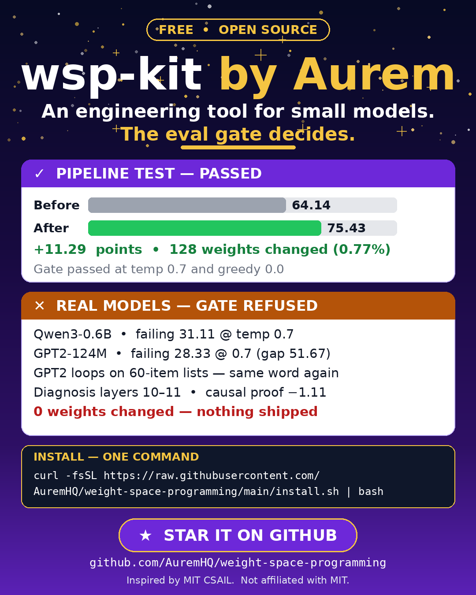
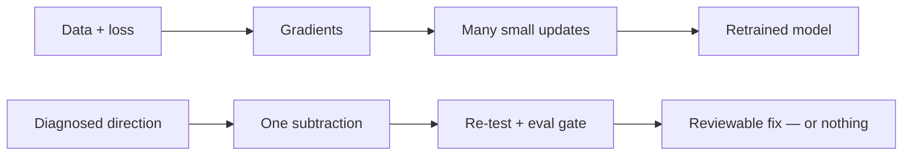

# wsp-kit by Aurem



**Edit a small model's weights to fix one stubborn failure. An eval gate decides what ships. If the numbers don't improve, nothing ships.**

[](LICENSE)
[](RESEARCH.md)
[](https://github.com/AuremHQ/weight-space-programming)


**No retraining. No gradients.** A tiny edit (under 1% of weights). One rule: **no gate, no ship.**

**7 real-model runs. The gate said: 5 refused, 2 shipped.** We publish the refusals too. Every run is in [REAL-RUNS.md](REAL-RUNS.md).

A gate says yes or no. It re-runs the same prompts. Gain at least **+2 points** and lose no more than 2 points on guards, or the edit is thrown away.

[See all 7 runs](REAL-RUNS.md) · [Share your run](#share-your-run) · [Website](https://auremhq.github.io/weight-space-programming/)

Not affiliated with MIT. This is an independent implementation inspired by their public research — full credit in [Credits](#credits).

---

## Try it in 2 commands

```bash
git clone https://github.com/AuremHQ/weight-space-programming && cd weight-space-programming
```

```bash
pip install './kit[real]' && wsp demo
```

`wsp demo` runs a quick pipeline check and writes `report.json`. For a real model:

```bash
wsp run --model Qwen/Qwen3-0.6B --eval kit/evals/loop-fix-qwen3-0.6b.json --out-dir out
```

If the gate fails, the out-dir holds only the report. Nothing ships.

Prefer one line? `curl -fsSL https://raw.githubusercontent.com/AuremHQ/weight-space-programming/main/install.sh | bash`, then `wsp auto` asks 4 questions and runs by itself. (Read the script first if you like. It is short.)

---

## Real runs: our numbers, not MIT's

### 7 real-model runs. 5 refused. 2 shipped.

| Model | Edit | Layers | Weights changed | Failing score |
|---|---|---|---|---|
| SmolLM2-1.7B-Instruct | subtraction | 23 | 129,897 (0.0076%) | 76.11 → 85.56 (+9.44) |
| Qwen3-0.6B (narrow animals-only eval) | dampening | [27, 26] | 131,072 (0.022%) | 37.78 → 67.22 (+29.44) |

Both passes fix one failure type: 60-item list looping. Numbers are points on the failing set. Source: [REAL-RUNS.md](REAL-RUNS.md). Not peer-reviewed.

Good and neighbour scores stayed at 100. No regression.

**What this shows:** the kit runs end to end on real models, and the gate refuses edits that don't earn their place.

**What it does not show:** that the kit fixes models in general. Both passes are the same failure type (60-item list looping), measured on 3 failing prompts. Quick evidence, not peer-reviewed, not yet reproducible from this repo.

All 8 rows, including the 5 refusals:

| Run | Model | Failure | Diagnosis | Causal proof | Weights changed | Gate |
|---|---|---|---|---|---|---|
| **Pipeline test** | Kit weights (smoke test) | Failing 64.14 vs good 75.98 | Row 0 | **+18.00 — PASSED** | **128 (0.77%)** | **PASSED — failing 64.14 → 75.43 (+11.29)** |
| **Qwen run 1** | Qwen3-0.6B | 60-item lists loop (60 animals → only 16 distinct) | Layers [27, 26] | −3.33 — FAILED | **0** | **FAILED — nothing shipped** |
| **Qwen run 2** | Qwen3-0.6B | Same failure | Layers [27, 26] | **+32.22 — PASSED** | **0** | **FAILED — nothing shipped** (attempt numbers contaminated by a restore bug — see clean re-run) |
| **Qwen clean re-run** | Qwen3-0.6B | Same failure, restore bug fixed | Layers [27, 26] | **+32.22 — PASSED** | **0** | **FAILED — nothing shipped** (all 3 clean attempts made failing worse: −11.11 / −11.11 / −12.22) |
| **GPT-2 run** | GPT2-124M | 60-item lists loop (animals 1.7, countries 5.0, fruits 1.7) | Layers [10, 11] | −1.11 — FAILED | **0** | **FAILED — nothing shipped** |
| **Qwen narrow Try 1** | Qwen3-0.6B | 60-item lists loop, narrow eval | Layers [27, 26] | **+23.89 — PASSED** | **0** | **FAILED — nothing shipped** (all 3 subtraction attempts destroyed the model at greedy) |
| **Qwen narrow dampen** | Qwen3-0.6B | Same failure, narrow eval | Layers [27, 26] | **+23.89 — PASSED** | **131,072 (0.022%)** | **PASSED — failing 37.78 → 67.22 (+29.44)** |
| **SmolLM2 run** | SmolLM2-1.7B-Instruct | 60-item lists loop (Butterfly ×2, Elephant ×2, Giraffe ×3) | Layer 23 | −30.00 — PASSED the v1 bar (|−30| ≥ 5), though the ablation made it worse | **129,897 (0.0076%)** | **PASSED — failing 76.11 → 85.56 (+9.44)** |

The pipeline test is a smoke test on the kit's own toy weights, not a real model.

---

## Is this for you?

| Yes, if... | No, if... |
|---|---|
| You have a **small open-weight model** (Qwen, Gemma, Llama class) in your own app | Your model is behind an API (ChatGPT, Claude). You never hold its weights |
| It has **one specific, repeatable failure**: looping, a stuck behaviour, a narrow quirk | You want to "make it smarter". Editing removes obstacles, it does not add abilities |
| You have test prompts that show the failure | Your model is large. Practical today for small models only |

---

## Honest limits

- The MIT work is a **blog post, not a peer-reviewed paper**, and has not been independently replicated.
- Shown mainly with **one editor model (GPT-6 Astra)**. Other editors are **unproven**. Our reports name the editor behind every run (ours is a numerical estimator, no LLM).
- It is a **batch job, not real-time**: load weights, evaluate, reason, edit, re-evaluate. It never runs live inside a chat reply.
- **2 passes out of 7 runs, one failure type.** That is the claim, nothing bigger.

---

## Share your run

The most useful thing you can do is run it on **your** model and tell us the numbers, including when the gate says no. A refusal is a real result.

1. Run the kit on your model and failure.
2. Open a [My run](https://github.com/AuremHQ/weight-space-programming/issues/new?template=my-run.yml) issue with your model, edit type and numbers.
3. Want to film it? The [reel kit](docs/REEL-KIT.md) has a 30-second script, an on-screen layout and a hashtag list.

First community test is still open on the roadmap: **your model, your failure, your numbers.**

---

## Where it started: MIT's numbers

```
MATH-500           7.9%  ████░░░░░░░░░░░░░░░░  →  48.1% ████████████████████
GSM8K             13.8%  ██████░░░░░░░░░░░░░░  →  67.1% ██████████████████████████
IFEval            21.0%  ████████░░░░░░░░░░░░  →  62.3% █████████████████████████
Answers hitting the token limit    93%  →  33%
Weights changed: 131,072 — just 0.016% of the model
```

The model (Qwen3.5-0.8B) kept repeating itself until it ran out of tokens. The researchers traced the loop to one direction written by the MLPs of layers 15 and 19, and subtracted it. The model didn't learn new math. **It already knew the math; the loop was hiding it.** Full details, all 8 experiments and the limits: [RESEARCH.md](RESEARCH.md).

---

## How the skill works, and what it refuses


1. **Detect.** Find the weights in your repo, run your model on your own test prompts, diagnose the failure, and measure it first (how often, how bad). That baseline is what the gate compares against. No weights or no test prompts: the skill refuses and does nothing.
2. **Fix.** Subtract the offending direction from the identified layers only. Anything over 1% of weights is rejected as "too broad."
3. **Eval-gate.** Re-run the *same* prompts with the *same* settings. The fix ships only if the primary metric improves by at least **2 points** with no guard-metric regression worse than **2 points**. Otherwise the edit is discarded. **No gate, no ship.**

**Refusals, and how each is enforced:**

- No eval file: enforced in code. The run stops with a plain message (exit 2), nothing edited.
- No weights (API-only model): partially enforced. The model loader fails and the run stops (exit 2), nothing edited. There is no dedicated pre-check.
- Add capability with no diagnosed obstacle: SKILL.md only, not enforced in code.
- Edit a production branch in place: SKILL.md only, not enforced in code.
- Remove safety/refusal behaviour: SKILL.md only. The v2 default guard bundle detects refusal regression after an edit. It does not prevent safety removal.

Full rules: [SKILL.md](SKILL.md).

**How it differs from gradient descent.** Training: data + loss → gradients → many small updates → a retrained model. This kit: one direct edit, no data, no gradients, no training loop, and the gate decides whether it ships.



If you want training, use training. If you want to try removing one stubborn failure without retraining, use this.

---

## All CLI safety flags and the MCP server

| Flag | Commands | What it does |
| --- | --- | --- |
| `--force` | `run`, `apply-edit`, `merge` | Allow an out-dir that already holds model files. Without it, the kit refuses to write over model weights. |
| `--allow-quick` | `serve-model`, `apply-edit` | Accept a report with no SHIP verdict (QUICK evidence). Without it, only SHIP reports are applied. |
| `--allow-unverified` | `apply-edit` | Apply an edit with no `report.json` next to it (no gate pass tied to the edit). |
| `--verify` | `apply-edit` | After applying, compare the sha256 of the changed tensors with `--expected-sha256` and print MATCH or DIVERGED (exit 1 on DIVERGED). |
| `--expected-sha256 HEX` | `apply-edit` | Recorded sha256 of the changed tensors (from the run's PROVENANCE.md); required with `--verify`. |
| `reproduce <run-dir>` | `reproduce` | Re-run a recorded run and print MATCH or DIVERGED on the primary metric within `--tolerance` points (default 5.0). Early reports with missing samples/seed/max tokens print "cannot be reproduced exactly: missing <fields>". |
| `--token TOKEN` (or `WSP_TOKEN`) | `serve-model` | Require a bearer token for `POST /generate` and `/rollback`. `/status` stays open. |
| `--protocol v1\|v2` | `run`, `watch`, `loop`, `merge` (`auto` defaults to v1) | v2 is standard evidence (default). `--protocol v1` restores the old measurement, labelled QUICK, never evidence. |
| `--dry-run` | `run` | Print the cost plan (prompt counts, generate calls per phase, total) and exit without loading or writing anything. |
| `--no-default-guards` | `run` | Turn the default guard bundle off (v2 only; the report records guards as disabled). |
| `--samples-per-prompt N` | `run`, `watch`, `loop`, `merge` | Samples at non-greedy temperatures (default: 1 for v1, 3 for v2). |

For agents and harnesses there is an MCP server. **Demo only:** every tool drives the built-in toy model. Use `wsp run` for real models. Install from a clone with `pip install './kit[mcp]'`, then:

```json
{
  "mcpServers": {
    "wsp-kit": {
      "command": "python",
      "args": ["-m", "wsp.mcp_server"]
    }
  }
}
```

---

## Keep it improving: wsp loop and wsp serve-model

Models fail at new things over time, so the kit can keep working in the background.

- **`wsp loop` watches for failures.** Write a failure in a file or drop in a test file and the kit runs the gated pipeline on it. A passing fix becomes a new version. A failing one ships nothing, and the same failure is never retried.
- **`wsp serve-model` serves your model and applies each new passing fix to the same running model.** No reload, no restart. Only ONE fix is active at a time: a newer passing fix first undoes the previous one (original weights restored exactly), then applies. Fixes replace, they never stack. One rollback returns the model to its original weights (it does not bring back the previous fix).

```bash
wsp loop --model Qwen/Qwen3-0.6B --watch-dir ./evals-incoming --out-dir ./wsp-loop-out
wsp serve-model --model Qwen/Qwen3-0.6B --versions-dir ./wsp-loop-out
```

Your app talks to the live model at `http://127.0.0.1:8900` (`POST /generate`). The same gate (+2/−2) and the 1% weight cap apply to every run. Only gate-passing edits for your exact model are applied, and the original weights are always kept for instant rollback.

---

## Weight deltas: one verified edit, saved small

When a run passes the gate, the kit saves the edit as a **delta** in `<out-dir>/deltas/<delta-id>/`: only the weights that changed (`delta.npz`) plus a JSON proof (`proof.json`) of the source model, what it was measured on, and the gate verdict. No full model copy, no network, nothing leaves your machine.

```bash
wsp delta list                          # saved deltas, oldest first
wsp delta show <delta-id>               # the full proof, as JSON
wsp delta apply <delta-id> --model base.npz --out edited.npz
```

Applying a delta writes a **new copy**. The old model is never overwritten. Before writing, the kit checks the proof (a gate pass must be recorded), the base hash, the 1% cap, and the round trip (patched weights differ from base by exactly the delta). Any failed check refuses and writes nothing.

---

## What's inside

- **[RESEARCH.md](RESEARCH.md)**: the MIT research explained simply, all 8 experiments, and where it fails.
- **[SKILL.md](SKILL.md)**: the skill: 3-step workflow, hard refusal rules, safety gates.
- **[REAL-RUNS.md](REAL-RUNS.md)**: our real-model runs with full numbers and honest verdicts.
- **[DEMO-PLAN.md](DEMO-PLAN.md)**: how the real runs were built, and the bar the next run must clear.
- **[kit/](kit/)**: engine, CLI, MCP server, task pack, and the universal real-model pipeline (`wsp run`).

---

## Questions, answered

**What is wsp-kit?**
A free, open-source tool for small models. It tries to fix one specific, repeatable failure in a small open-weight model by editing its weights directly. No retraining, no fine-tuning, no gradients.

**Does it fix real models?**
Twice so far, out of seven runs. Two real-model edits passed the gate: SmolLM2-1.7B-Instruct (+9.44) and Qwen3-0.6B narrow-animals by dampening (+29.44). The other five real-model runs failed the gate and shipped 0 weights. See [REAL-RUNS.md](REAL-RUNS.md).

**What is the eval gate?**
It re-runs the same prompts with the same settings after an edit. The edit ships only if the failing metric improves by at least 2 points with no more than 2 points regression on guards and neighbours, at serving temperature and greedy.

**Which models work?**
Small open-weight models you control. Closed API models (ChatGPT, Claude) are refused. Their weights are never in your hands.

**Is it free?**
Yes. MIT licensed. A small model should not mean bad results.

---

## Founder's vision

Big AI should not belong only to people who can pay for big models and big retraining bills. Small, local, cheap models are already in everyone's hands. They just need to perform at their best. This kit exists to make a small local model give better results, one tiny proven edit at a time, without retraining and without sending your data anywhere. If the numbers don't improve, nothing ships. That honesty is the product.

**This kit is free for everyone, and it stays free.** A small model should not mean bad results — everyone has the right to the best experience and the best results.

— Tejinder Sandhu, founder, Ora by Aurem ([auremcto.com](https://auremcto.com)) · [Tejinder Sandhu on LinkedIn](https://www.linkedin.com/in/tejinder-sandhu-156a3a181)

---

## Roadmap

- [x] Research summary + skill spec
- [x] Real runs live: Qwen3-0.6B + GPT2-124M + SmolLM2-1.7B, gate enforced
- [x] Easy mode: `wsp auto` asks 4 questions and runs by itself
- [x] Continuous loop + live model (`wsp loop`, `wsp serve-model`)
- [x] First passing edits on real models: SmolLM2 (+9.44) and Qwen narrow (+29.44)
- [x] Weight deltas: every gate-passing edit saved small, with proof
- [ ] Weight sync: one user's refined weights make everyone better (design only, not built)
- [ ] Demo video/GIF + example report
- [ ] First community test: your model, your failure, your numbers

---

## If this is useful, star it

A star is how you follow the next run (GitHub tells you when new numbers land), and how a small free project shows people want it. If you know someone with a looping small model, send them this page.

Built by the team behind [Ora by Aurem](https://auremcto.com), an AI engineer for non-technical founders. ORA stays private. This kit is public so anyone can use it on their own models.

---

## Credits

Research: *"Sparks of Weight-Space Programming: LLMs can natively read & write neural network weights"*, Rikiya Takehi, Jayden Teoh, Alex Zhang, Omar Khattab, MIT CSAIL, 2 Nov 2026. [Blog](https://rikiyat.github.io/blog/weight-space-programming/) · [Experiment logs](https://github.com/RikiyaT/lm_understand-logs)

Skill design and packaging: the team at [Ora by Aurem](https://auremcto.com), founded by Tejinder Sandhu.

---

## License

MIT, see [LICENSE](LICENSE). If it fixes something for you, a star and a note about your numbers would mean a lot.
