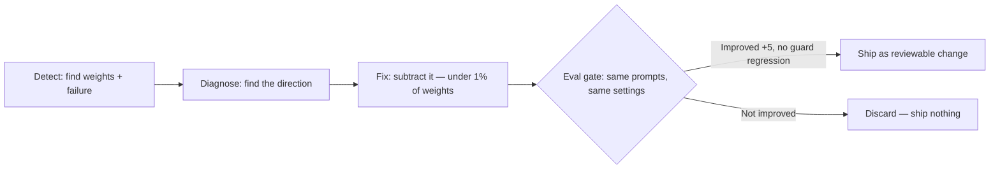

# Weight-Space Programming

> Fix small AI models by editing their weights directly — no retraining, no fine-tuning, no gradients.

[](LICENSE)
[](RESEARCH.md)
[](https://github.com/AuremHQ/weight-space-programming)


> From the team building **Ora by Aurem — https://auremcto.com** — an AI engineer for non-technical founders. ORA itself stays private; this skill is public so anyone can use it on their own models.

> ⭐ **Star this repo** if you want the runnable demo with real numbers — it lands here next.
> 🔁 **Share it** with anyone running a small open model with one stubborn failure.

---

## The 30-second version

- **MIT CSAIL showed** a frontier model can read and write neural network weights directly — no training, no gradients.
- **One tiny edit** (0.016% of weights) fixed a model's reasoning loop: MATH **7.9% → 48.1%**.
- **This repo turns that idea into a skill** you can run on your own small open-weight model — with evaluation, not enthusiasm, deciding whether any edit ships.

**This repo is not affiliated with MIT.** It is an independent implementation inspired by their public research, with full credit below.

---

## The result that started it — MIT's numbers, not ours (ours are coming)

```
MATH-500           7.9%  ████░░░░░░░░░░░░░░░░  →  48.1% ████████████████████
GSM8K             13.8%  ██████░░░░░░░░░░░░░░  →  67.1% ██████████████████████████
IFEval            21.0%  ████████░░░░░░░░░░░░  →  62.3% █████████████████████████
Answers hitting the token limit    93%  →  33%
Weights changed: 131,072 — just 0.016% of the model
```

How: the model (Qwen3.5-0.8B) kept getting stuck repeating itself until it ran out of tokens. The researchers traced the loop to one direction written by the MLPs of layers 15 and 19, and subtracted it. The model didn't learn new math — **it already knew the math; the loop was hiding it.**

Full details, all 8 experiments, and the honest limits: see [RESEARCH.md](RESEARCH.md).

---

## How the skill works



1. **Detect** — Find the weights in your repo, run your model on your own test prompts, diagnose the failure. No weights, no test prompts, or a model that's too large → the skill refuses, clearly, and does nothing.
2. **Fix** — Subtract the offending direction from the identified layers only. Edits are tiny by design: anything over 1% of weights is rejected as "too broad."
3. **Eval-gate** — Re-run the *same* prompts with the *same* settings. The fix ships only if the primary metric improves by at least 5 points with no guard-metric regression worse than 2 points. Otherwise the edit is discarded. **No gate, no ship.**

Full rules, refusals, and safety gates: see [SKILL.md](SKILL.md).

---

## What's inside

- **[RESEARCH.md](RESEARCH.md)** — the MIT research, explained simply: what weight-space programming is, all 8 experiments with numbers, and where it fails.
- **[SKILL.md](SKILL.md)** — the Weight-Space Programming skill: the 3-step workflow, hard refusal rules, and safety gates.
- **[DEMO-PLAN.md](DEMO-PLAN.md)** — how the runnable demo is being built, and the exact numbers it must show before anyone should trust it.

---

## Who this is for

| ✅ This is for you if… | ❌ This is NOT for you if… |
|---|---|
| You have a **small open-weight model** (Qwen, Gemma, Llama class) in your own app or software | Your model is served by an API (ChatGPT, Claude…) — its weights are never in your hands |
| It has **one specific, repeatable failure** — looping, a stuck behaviour, a narrow quirk | You want to "make my model smarter" — editing removes obstacles, it does not add abilities |
| You have test prompts that show the failure | Your model is large — this is practical today only for small models |

---

## Try it on your model

1. Point the skill at your weights and your failing prompts.
2. Get a diagnosis and a tiny, reviewable edit.
3. Let the eval gate decide — if the numbers don't improve, nothing ships.

That's the whole deal. No retraining bill, no blind trust.

---

## Honest limits — why you can trust this repo

- The MIT work is a **blog post, not a peer-reviewed paper**, and has not yet been independently replicated.
- Demonstrated so far mainly with **one editor model (GPT-6 Astra)**. Whether other models do this equally well is **unproven** — our demo will name the model behind every edit.
- This is a **batch job, not real-time**: load weights, run evaluations, reason, edit, re-evaluate. It never runs live inside a chat reply.
- **Our own demo numbers are not here yet.** That is exactly what the next milestone delivers — star the repo to see them land.

---

## Roadmap

- [x] Research summary + skill spec
- [ ] **Runnable demo: loop-fix on a small open model, with reproducible before/after numbers** ← next
- [ ] Demo video/GIF + example report
- [ ] First community test: your model, your failure, your numbers

---

## ⭐ Star & share

- **Star** = you follow the demo. GitHub notifies you when the real numbers land here.
- **Share** = someone with a looping small model finds a fix instead of paying for a full retraining run.
- **Built by the team behind https://auremcto.com** — Ora by Aurem, an AI engineer for non-technical founders.

---

## Credits

- Research: *"Sparks of Weight-Space Programming: LLMs can natively read & write neural network weights"* — Rikiya Takehi, Jayden Teoh, Alex Zhang, Omar Khattab, MIT CSAIL, 2 Nov 2026. Original blog: https://rikiyat.github.io/blog/weight-space-programming/ · Full experiment logs: https://github.com/RikiyaT/lm_understand-logs
- This repo's skill design and packaging: the team building [Ora by Aurem](https://auremcto.com). ORA itself stays private; this skill is public so anyone can use it on their own models.

## License

MIT — see [LICENSE](LICENSE). Use it in your own model, app, or software. If it fixes something for you, a star and a note about your numbers would mean a lot.
